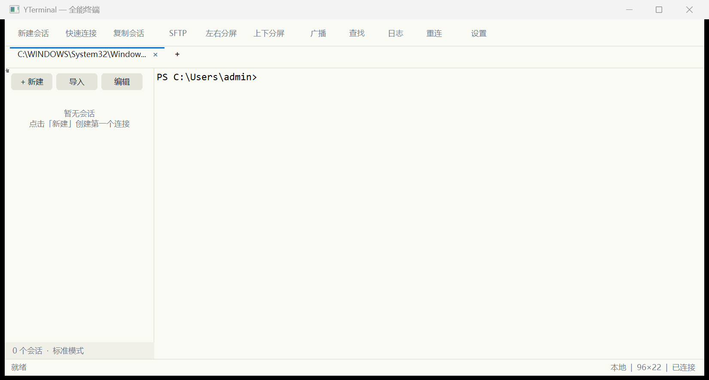

# YTerminal

纯 C 编写的 Windows 全能终端：单文件 EXE、零运行时依赖，对标 WindTerm / SecureCRT / MobaXterm。



- **248 KB** 单文件（`YTerminal.exe`），无 Python、无 Electron、无 .NET、无 VC++ 运行库
- 只用 Win32 + GDI + 系统 OpenSSH，全部依赖都是 Windows 自带的
- SSH / Telnet / 串口 / 本地 Shell（ConPTY）四种会话，一个界面里跑
- 自研 VT100–xterm 解析器：256 色、真彩、宽字符、备用屏、鼠标上报、括号粘贴、OSC 标题与通知

---

## 为什么是它

| 维度 | WindTerm | SecureCRT | MobaXterm | **YTerminal** |
| --- | --- | --- | --- | --- |
| 体积 | ~30 MB | ~60 MB | ~40 MB（Free 版功能受限） | **248 KB** |
| 依赖 | Qt 运行时 | 商业组件 | 自带工具链 | **仅系统 OpenSSH** |
| 授权 | Apache-2.0 | 商业收费 | 免费版有站点数限制 | **MIT** |
| 会话编码 | 支持 | 支持 | 支持 | **支持（UTF-8/GBK/BIG5/SJIS/EUC-KR，且广播时按会话各自转换）** |
| 拖放上传 | 支持 | 有限 | 支持 | **支持（SSH 走 scp，本地走命令行插入）** |
| 链接跳转 | 支持 | 支持 | 支持 | **Ctrl+点击打开 http/ftp/file/www** |
| 配置导入 | 部分 | 导入 SecureCRT | 导入 PuTTY | **SecureCRT / MobaXterm / PuTTY / OpenSSH ~/.ssh/config** |
| 启动速度 | 秒级 | 秒级 | 秒级 | **毫秒级（无框架冷启动）** |

> 说明：上表只列差异点，不宣称全面超越；YTerminal 目前仍是 v1.0 阶段，路线图见文末。

## 功能

### 会话与协议

- **SSH**：调用系统 `ssh.exe`，支持私钥、ssh-agent、键盘交互、保活、跳板机 `-J`、隧道 `-L/-R/-D`、附加参数
- **Telnet**：自带 IAC 协商（NAWS 窗口尺寸、TTYPE 终端类型、ECHO）
- **串口**：原生 Win32 串口，波特率/数据位/校验/停止位可配
- **本地 Shell**：ConPTY 承载 PowerShell / cmd / WSL
- 密码用 **DPAPI** 加密存储在本地配置里，不落明文
- 断线自动重连、会话树分组、收藏、备注、前缀搜索

### 终端内核

- VT100/xterm 解析：CSI、DEC 字符集、滚动区、插入/删除行列、备用屏
- 颜色：16 色 / 256 色 / 真彩（0x01RRGGBB → GDI COLORREF）
- 宽字符（CJK 双宽）与续格处理、组合字符不吞字
- 鼠标上报（X10 / SGR）、括号粘贴、OSC 0/2 标题、OSC 9/777 通知
- 历史行滚动、选区复制、查找（大小写敏感/不敏感）、行号定位
- IME 中文输入、DPI 感知、字体缩放（Ctrl+= / Ctrl+-）

### 效率工具

- **多标签 + 左右/上下分屏**，标签可拖拽重命名、复制会话
- **广播输入**：一次输入发给所有可见会话，且每个会话按自己的编码转换
- **快捷命令**（每行 `命令|说明`，Ctrl+Shift+K 弹出）、**触发器**（`匹配=>发送`，自动应答 Password 之类）
- **日志**：整段会话落盘
- **SFTP 窗口**：单文件上传/下载/删除（走系统 `sftp`/`scp` 批处理）
- **主题 / 透明度**、工具栏可隐藏、侧栏可折叠
- **工作区恢复**：退出时记住标签与分屏结构

### 新增（v1.0 本轮）

1. **会话编码**：UTF-8 / GBK / BIG5 / Shift-JIS / EUC-KR，入站解码保留跨包半字符，出站按会话编码转换
2. **Ctrl+点击链接**：识别 `http(s)://`、`ftp://`、`file://`、`www.`，命中时鼠标变手型，`ShellExecute` 打开
3. **拖放文件**：把文件拖进终端窗口
   - 本地会话：插入带引号的路径到命令行
   - SSH 会话：后台线程 `scp` 上传到远端家目录，完成后状态栏提示
4. **`~/.ssh/config` 导入**：解析 Host / HostName / User / Port / IdentityFile / ProxyJump，跳过通配 Host
5. **构建零告警**：`-Wall -Wextra` 下无 warning

## 快速开始

### 直接使用

下载 Release 里的 `YTerminal.exe` 双击即可（`YTPass.exe` 需与它同目录，用于 SSH 密码输入桥接）。

要求：Windows 10 1809+（ConPTY），系统自带 OpenSSH 客户端（Win10 1809+ 默认包含）。

### 从源码构建

需要 MSYS2（mingw64）+ gcc：

```powershell
# 安装 MSYS2 后
pacman -S mingw-w64-x86_64-gcc
cd C:\code\YTerminal
powershell -ExecutionPolicy Bypass -File .\build.ps1
```

产物：

- `build\YTerminal.exe`（约 248 KB）
- `build\YTPass.exe`（SSH_ASKPASS 密码桥）

构建参数：`-O2 -Wall -Wextra`，`-mwindows -static -static-libgcc -s`，资源用 `windres` 编译。

### 单元测试

```powershell
$env:PATH = "C:\msys64\mingw64\bin;$env:PATH"
gcc -std=c11 -O2 -Wall -I src tests\test_vt.c src\vt.c src\util.c -o build\test_vt.exe -lkernel32
.\build\test_vt.exe
```

当前：**46 项全通过**。

### 界面自检（无侵入截图）

```powershell
powershell -ExecutionPolicy Bypass -File .\scripts\ui-shot.ps1 -SessionDialog
```

用 `PrintWindow` 抓取被遮挡窗口，按 DPI 缩放倍率生成位图，不抢鼠标键盘。

## 使用要点

### 会话编码

新建/编辑会话时，顶部「分组」右侧有「编码」下拉：

- 连老设备/国产交换机常用 **GBK**
- 台湾/香港设备用 **BIG5**
- 日文设备用 **Shift-JIS**
- Linux 服务器基本都用 **UTF-8**

广播输入时，每个会话按自己的编码独立转换，不会互相污染。

### 拖放上传

把本地文件直接拖进终端：

- 本地会话 → 在当前命令行插入 `"C:\path\file"`（可直接接命令，如 `type `）
- SSH 会话 → 后台 `scp -P <port> ...` 上传到远端 `~`，状态栏显示进度结果
- Telnet / 串口 → 提示改用 SFTP 窗口

### 配置导入

侧栏「导入」菜单：

1. 从 SecureCRT 导入
2. 从 MobaXterm 导入
3. 从 PuTTY 导入（注册表）
4. 自动扫描并全部导入
5. 从 OpenSSH `~/.ssh/config` 导入 ← 本轮新增

`~/.ssh/config` 会解析 `Host` 块，跳过 `Host *` 通配段，`IdentityFile` 里的 `~` 自动展开成 `%USERPROFILE%`。

### 快捷键

| 按键 | 功能 |
| --- | --- |
| `Ctrl+T` | 新建会话 |
| `Ctrl+W` | 关闭当前标签 |
| `Ctrl+Shift+C` / `Ctrl+Shift+V` | 复制 / 粘贴 |
| `Ctrl+F` | 查找 |
| `Ctrl+Shift+F` | 查找下一个 |
| `Ctrl+Shift+E` / `Ctrl+Shift+D` | 左右分屏 / 上下分屏 |
| `Ctrl+Shift+K` | 快捷命令菜单 |
| `Ctrl+Shift+S` | SFTP 窗口 |
| `Ctrl+Shift+L` | 日志开关 |
| `Ctrl+=` / `Ctrl+-` | 放大 / 缩小字号 |
| `Ctrl+点击` | 打开链接 |
| `Shift+Tab` | 发送 `ESC [ Z`（反向 Tab） |

### 配置文件位置

```
%APPDATA%\YTerminal\settings.json   界面/字体/主题
%APPDATA%\YTerminal\sessions.json   会话、分组、快捷命令、触发器
```

均为 UTF-8 JSON，密码字段是 DPAPI 密文（只在同一用户下可解）。

## 工程结构

| 文件 | 职责 |
| --- | --- |
| `src/main.c` | 入口、DPI 感知、单实例 |
| `src/app.c/.h` | 全局状态、字体、DPI 换算 `app_dpi()`、命令分发 |
| `src/backend.c/.h` | SSH / Telnet / 串口 / ConPTY 后端，`WM_YT_BACK_DATA` 回传 |
| `src/vt.c/.h` | 自研 VT 解析器与屏幕缓冲（历史行、选区、查找、备用屏） |
| `src/ui_term.c/.h` | 终端视图：绘制、键盘映射、鼠标、粘贴、链接、拖放 |
| `src/ui_main.c` | 主窗口：工具栏、标签栏、侧栏、命令处理 |
| `src/ui_split.c` | 分屏布局 |
| `src/ui_widgets.c` | 自绘控件（标签、按钮、滚动条） |
| `src/ui_sftp.c` | SFTP 窗口 |
| `src/ui_dialogs.c` | 会话/设置/快捷命令/关于 等对话框 |
| `src/importer.c` | SecureCRT / MobaXterm / PuTTY / OpenSSH 配置导入 |
| `src/session.c/.h` | 会话模型、JSON 持久化、DPAPI |
| `src/theme.c/.h` | 配色主题 |
| `src/json.c/.h` | 轻量 JSON 读写（无第三方库） |
| `src/util.c/.h` | UTF-8/UTF-16 转换、编码转换、路径、DPAPI |
| `src/askpass.c` | 独立的 `SSH_ASKPASS` 小工具 |
| `tests/test_vt.c` | VT 内核单元测试 |
| `scripts/ui-shot.ps1` | 无侵入界面截图（PrintWindow） |

关键约定：

- 中文注释是 **UTF-8 无 BOM**，用 ANSI 读写会乱码
- VT 颜色是 `0x01RRGGBB`，必须经 `app_cr()` 转成 GDI `COLORREF`
- 布局坐标全部走 `app_dpi()`，否则 150% DPI 下会错位

## 已知限制

- SFTP 仅单文件操作，无目录树浏览（计划中）
- Telnet 无 SSL/TLS（stunnel 可绕）
- 无 ZMODEM 传输
- 无 Linux/macOS 版本（Win32/GDI 深度绑定）
- 会话对话框的分组/编码行宽度按 150% DPI 校准，100% DPI 下略显拥挤

## Roadmap

- [x] 会话编码（GBK/BIG5/SJIS）
- [x] Ctrl+点击链接
- [x] 拖放上传
- [x] `~/.ssh/config` 导入
- [ ] SFTP 目录树 + 批量传输 + 拖拽下载
- [ ] 终端配色与 ANSI 主题预设
- [ ] 命令补全（历史 + 远端 shell 补全）
- [ ] 会话同步（可选导出加密包）
- [ ] 多语言界面（英文）
- [ ] 插件式协议后端

## License

MIT，见 [LICENSE](LICENSE)。
