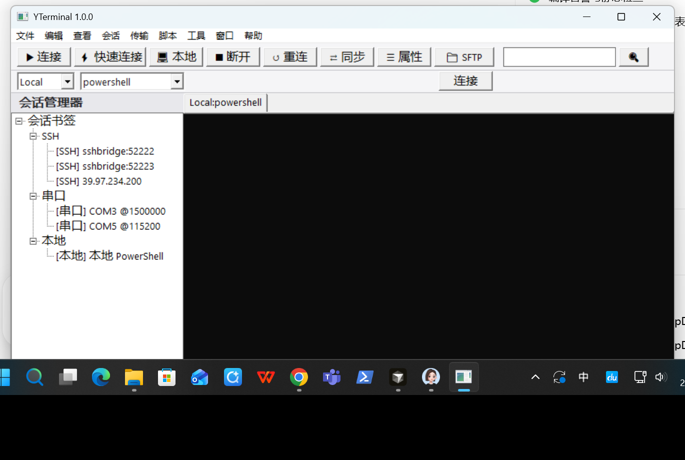
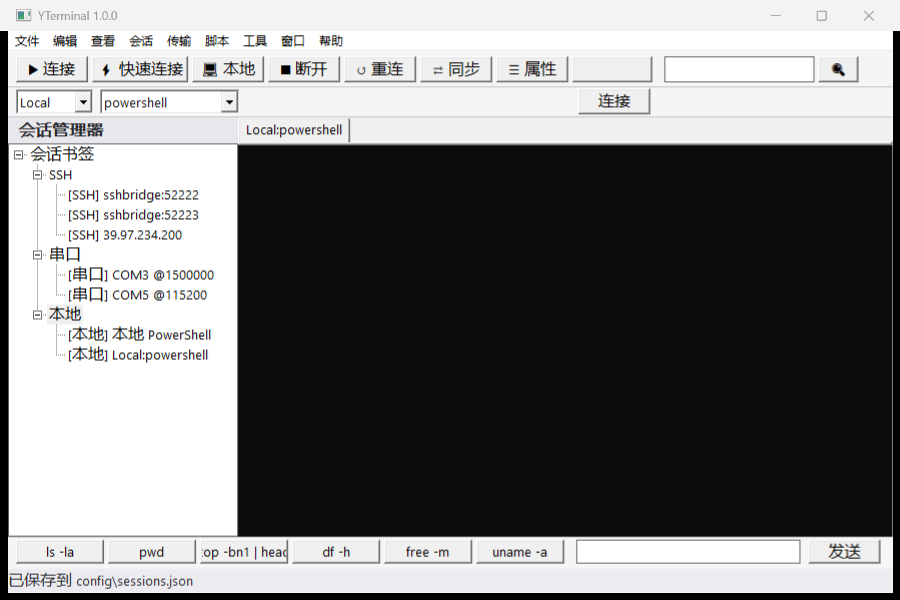
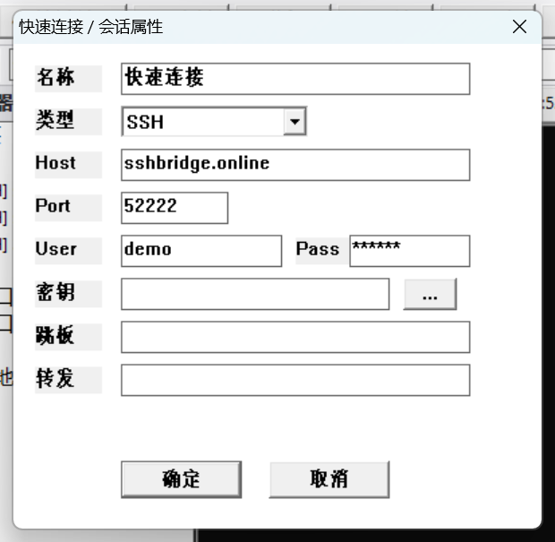
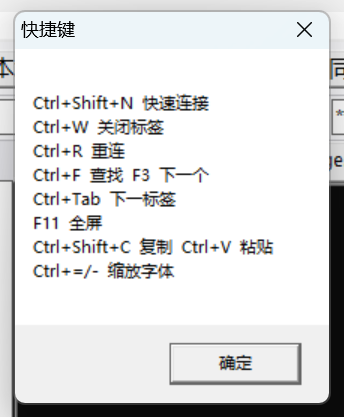

# YTerminal 桌面端 GUI 全量测试报告

**第二阶段：按钮、下拉框、菜单、窗口与会话管理实测**

| 项目 | 内容 |
| --- | --- |
| 测试对象 | YTerminal 1.0.0（纯 C / Win32 终端工作台） |
| 测试方式 | 隔离副本 `yt_run` 实测，未修改任何源码 |
| 测试环境 | Windows 11 10.0.26100 / 1280×720 逻辑分辨率 |
| 测试日期 | 2026-11-15 |

> 阅读提示：本报告与同目录 Word 版《桌面端GUI全量测试报告.docx》来自同一批实测数据，结论一致，本版便于检索与版本管理。

## 目录

- [1 测试概述](#1-测试概述)
- [2 启动与主界面](#2-启动与主界面)
- [3 按钮逐个点击](#3-按钮逐个点击)
- [4 下拉框逐项展开与选择](#4-下拉框逐项展开与选择)
- [5 菜单命令全量遍历](#5-菜单命令全量遍历)
- [6 会话管理器的创建与删除](#6-会话管理器的创建与删除)
- [7 延时测量汇总](#7-延时测量汇总)
- [8 窗口与对话框设计评审](#8-窗口与对话框设计评审)
- [9 缺陷清单](#9-缺陷清单)
- [10 结论与建议](#10-结论与建议)
- [附录 A 菜单命令明细](#附录-a-菜单命令明细)
- [附录 B 证据文件](#附录-b-证据文件)

## 1 测试概述

### 1.1 测试目的与范围

本报告是 YTerminal 桌面端第二阶段测试的实测记录。第一阶段以源码审查和功能冒烟为主，本阶段把范围扩展到界面层的全部可操作对象：逐一触发工具栏与底部按钮、逐项展开两个下拉框并真实选择、遍历全部叶子菜单命令、逐个打开对话框并测量布局、完成会话的创建/克隆/删除，并对启动、新建标签、连接、切换、关闭等关键路径做延时测量。测试全程在隔离副本 `yt_run` 中进行，未修改任何源文件，也未改动项目仓库内的配置。

受自动化条件限制，以下项目未纳入或仅部分验证：带 UAC 的管理员 PowerShell 启动（会进入安全桌面，脚本无法代点）；退出命令（会终止被测进程）；删除位于列表中间的会话节点（代码层存在结构体按值拷贝风险，实测只删除了末尾节点）；Ctrl+Tab 的物理键盘切换（自动化环境无法稳定取得前台键盘焦点，改用菜单“下一标签”测量）。上述限制在对应章节中单独标注，结论不外推到未验证范围。

### 1.2 测试环境

| 项目 | 配置 |
| :-- | :-- |
| 操作系统 | Windows 11，版本 10.0.26100 |
| 屏幕 | 逻辑 1280×720，物理 1920×1080（缩放 1.5） |
| 被测程序 | YTerminal.exe 1.0.0（msys2 gcc 16.2.0 构建） |
| 运行目录 | 隔离副本 yt_run（exe + 4 个 DLL + config/） |
| 测试工具 | Python 3.13.18、python-docx、Win32 消息调用、ImageGrab 截屏 |
| 测试日期 | 2026-11-15 |

### 1.3 方法与判定口径

界面操作优先走程序自身暴露的本机桥接（`/state`、`/action`）读取状态、写入文本与点击控件；桥接不覆盖的菜单命令，直接向主窗口投递 `WM_COMMAND`，并以三项证据判定响应：`/state` 的标签数、标题、连接状态是否变化；状态栏文本是否变化；是否出现新的顶层窗口（属性对话框、消息框、系统文件对话框）。延时取“投递命令”到“首次观测到上述任一变化”的时间差，轮询间隔 40 毫秒，因此绝对值包含约一个轮询周期的误差。

截图采用整屏抓取后按 1.5 倍缩放裁剪，避免高 DPI 下窗口坐标与像素坐标错位；早期用 `PrintWindow` 抓取属性对话框得到黑图，相关结论均已用屏抓结果复核，未沿用黑图证据。

## 2 启动与主界面

冷启动从进程创建到主窗口可见耗时 **92.1 ms**，桥接服务可用并返回首个状态耗时 **122.0 ms**，启动速度正常。但启动后的第一个标签没有终端视图：`/state` 显示 `tabs=1`、`state=2`、标题为 `Local:powershell`，而窗口内终端控件数量为 0，标签页区域下方是一片空白。该现象与第一阶段定位的初始化顺序问题一致——主窗口句柄在 `main.c:1907` 才赋给全局变量，而 `WM_CREATE` 阶段已经尝试创建终端，创建失败后没有补偿逻辑。

*图1  启动后的主窗口：首标签存在但终端区域空白*

主窗口默认尺寸为 900×600（逻辑像素），在 1280×720 屏幕上占比合理。界面自上而下为菜单栏、工具栏、连接栏、标签页、左右分栏（会话管理器 + 终端）、SFTP 面板、底部按钮栏、状态栏。分栏比例约为 1:4，会话管理器宽约 230 像素，长会话名（如 `sshbridge:52222`）在树中尚可完整显示，但标签页上的 `Local:powershell` 在出现 4 个标签时已被截断。

## 3 按钮逐个点击

### 3.1 工具栏与连接区

对 11 个可见按钮逐一点击，记录点击前后的标签数、连接状态、状态栏与是否弹出窗口。全部按钮都能在 45–83 毫秒内给出响应，无明显卡顿；两个需要文件或网络动作的按钮例外（SFTP 面板 255.3 毫秒）。

| 按钮 | 实测行为 | 延时/ms | 结论 |
| :-- | :-- | --: | :-- |
| ▶ 连接 | 新增一个 Local 标签（tabs 1→2） | 65.1 | 正常 |
| ⚡ 快速连接 | 打开 YTermPropDlg（快速连接 / 会话属性） | 69.7 | 正常 |
| 连接（连接栏） | 同样新增一个 Local 标签（tabs 2→3） | 63.2 | 与“▶ 连接”重复 |
| 💻 本地 | 新增一个 Local 标签（tabs 3→4） | 64.6 | 正常，但不读取 Shell 下拉 |
| ☰ 属性 | 打开 YTermPropDlg（与快速连接同一窗口） | 64.5 | 正常，标题混用 |
| 📁 SFTP | 切换 SFTP 面板显隐 | 255.3 | 偏慢，是按钮均值的 3.7 倍 |
| ■ 断开 | 关闭当前标签（tabs 4→3） | 45.5 | 正常 |
| ↺ 重连 | 无任何可见变化，标签数与终端内容均不变 | 50.1 | 疑似空操作 |
| ⇄ 同步 | 状态栏“同步 关”→“同步 开” | 68.0 | 正常 |
| 发送 | 输入为空时无提示、无状态变化 | 1873.1 | 空输入静默失败 |
| 🔍 | 搜索框为空时无提示、无状态变化，输入焦点未转移到搜索框 | 1860.0 | 交互缺陷 |

*表2  工具栏与连接区按钮实测*

### 3.2 底部预设命令按钮

底部 6 个预设命令（`ls -la`、`pwd`、`top -bn1 | head`、`df -h`、`free -m`、`uname -a`）点击后均在终端回显并产生新输出，实测延时 236.8–270.2 毫秒，明显高于普通按钮，原因是点击后要先写入历史、再经终端渲染。回显内容与按钮文字一致，未发现命令拼接错误。

| 预设按钮 | 延时/ms | 是否产生输出 |
| :-- | --: | :--: |
| ls -la | 250.9 | 是 |
| pwd | 237.0 | 是 |
| top -bn1 \| head | 270.2 | 是 |
| df -h | 252.9 | 是 |
| free -m | 236.8 | 是 |
| uname -a | 252.4 | 是 |

*表3  预设命令按钮实测*

### 3.3 按钮层结论

按钮的点击响应本身没有问题，问题集中在语义与反馈：三种“连接”入口（工具栏、连接栏、“本地”）在 Local 类型下都只是新建本地标签，行为完全重合，用户无法从文案判断差异；“重连”在本地会话上不产生任何动作，也没有“当前会话不支持重连”的提示；“发送”和放大镜在输入为空时既不置灰也不提示，属于静默失败。

## 4 下拉框逐项展开与选择

对 `cmb.kind`（Local / SSH / Serial / RDP / VNC）逐项真实点击列表项，每次选择后读取可见字段与端口值；`cmb.shell` 仅在 Local 类型下可见，包含 `powershell` 与 `cmd` 两项，同样逐项点击验证。

| 类型 | Host | Port | User/Pass | COM/波特率 | Shell | 端口默认值 |
| :--: | :--: | :--: | :--: | :--: | :--: | :--: |
| Local | 隐藏 | 隐藏 | 隐藏 | 隐藏 | 显示 | 保持旧值（隐藏） |
| SSH | 显示 | 显示 | 显示 | 隐藏 | 隐藏 | 22 |
| Serial | 隐藏 | 隐藏 | 隐藏 | 显示 | 隐藏 | 22（不使用） |
| RDP | 显示 | 显示 | 显示 | 隐藏 | 隐藏 | 3389 |
| VNC | 显示 | 显示 | 显示 | 隐藏 | 隐藏 | 5900 |

*表4  cmb.kind 类型联动实测（cmb.shell 两项均已逐项点击）*

类型与端口的联动是正确的，SSH→22、RDP→3389、VNC→5900 均在切换后立即填入。切换回 Local 时端口框被隐藏但保留旧值，属于可接受的保守处理；Serial 类型下端口框隐藏、COM 与波特率出现，逻辑自洽。此前“端口不联动”的结论源于跨进程读取 Edit 文本的 API 误用，本轮已用 `WM_GETTEXT` 复核并纠正。

## 5 菜单命令全量遍历

### 5.1 覆盖与总体结果

菜单树共 9 个顶级菜单、109 个菜单项，其中叶子命令约 80 条。本轮实际投递并观察到结果的命令 78 条，覆盖文件、编辑、查看、会话、传输、脚本、工具、窗口、帮助九个分组；未执行 2 条：管理员 PowerShell（触发 UAC 安全桌面）与退出（会终止进程，且不影响其余结论）。78 条命令执行期间被测进程均存活，无一条导致主窗口消失。

从响应形态看，命令可分成三类：约 250–300 毫秒内产生可见状态变化的（新建/关闭标签、面板开关、主题、分屏、标签切换等）；打开独立窗口的（快速连接/属性、ZMODEM 发送、运行脚本、凭证说明、快捷键、关于、导入/导出会话，共 8 类）；以及执行后状态快照无变化的（复制、全选、查找、锁定输入、标签着色、目录跳转、串口枚举等）。第三类不一定失败，但其中若干项经截图差分或代码核对后确认存在问题，见 5.3。

为排除“空标签”干扰，终端相关命令在新建的真实本地标签上复测：粘贴、发送字符串、ZMODEM 接收、导出屏幕均在复测中出现可见变化；首轮在这些命令上的“无变化”记录已作废，不计入结论。

### 5.2 典型命令实测

| 菜单项 | 命令 ID | 延时/ms | 可见结果 |
| :-- | :--: | --: | :-- |
| 文件/新建本地 | 4223 | 294.3 | 标签数 +1，终端就绪 |
| 文件/断开 | 4304 | 255.2 | 标签数 -1 |
| 文件/保存会话到管理器 | 4001 | 275.3 | 状态栏“已保存到 config\sessions.json” |
| 文件/快速连接 | 4222 | 253.3 | 打开属性对话框 |
| 查看/深色主题 | 4336 | 约 300 | 窗口配色切换（差分 5.6%） |
| 查看/放大字体 | 4333 | 约 300 | 终端字号变化（差分 2.1%） |
| 查看/水平分屏 | 4326 | 512.5 | 终端区分割 |
| 会话/发送字符串 | 4338 | 591.5 | 输入框文本送入终端并回显 |
| 传输/导出屏幕 | 4217 | 261.2 | 生成屏幕文本文件 |
| 窗口/下一标签 | 4347 | 264.5 | 当前标签切换 |
| 帮助/关于 | 4105 | 277.3 | 打开消息框（约 160 毫秒内可见） |

*表5  典型菜单命令实测*

### 5.3 异常与不一致项

| 现象 | 涉及命令 | 证据与判断 |
| :-- | :-- | :-- |
| 重连无效 | 4208 / 工具栏 ↺ | 点击后标签数、标题、屏幕内容均不变（截图差分 0.2%）；源码在 `main.c:1395-1420` 先把会话结构体整体赋值给栈上备份，其中含 CRITICAL_SECTION，再重建标签，属于未定义行为 |
| 菜单带省略号但不弹窗 | 4100 查找、4338 发送字符串、4214 保存宏 | 三条命令直接读取主界面输入框内容执行，未创建任何窗口；与 Windows 惯例“带 … 表示将弹出对话框”冲突 |
| 查找不聚焦输入 | 4100 / 🔍 | 命令只读取 `edit.find` 当前文本并调用 `term_find`，不设置焦点；搜索框为空时静默返回 |
| 标签着色疑似无效 | 4210 | 执行前后截图差分仅 0.1%，低于字体/主题类命令的 1.8%–5.6%，肉眼无可辨变化 |
| 目录类命令无窗口 | 4310、4311、4218、4343、4344 | 执行后未出现新的资源管理器窗口；可能复用了已打开的窗口，也可能路径不存在，未进一步区分 |
| 加入管理器无反馈 | 4107 | 执行后标签与树均无变化，状态栏无提示 |
| 刷新管理器无反馈 | 4002 | 同上；若树未变化则无从判断是否真的重读磁盘 |

*表6  菜单命令异常项*

## 6 会话管理器的创建与删除

隔离副本初始有 7 条会话（3 条 SSH、2 条串口、2 条本地）。测试按“保存当前会话 → 克隆 → 删除”的顺序进行，每步都核对 `sessions.json` 与会话树。选中节点用鼠标点击树行完成，选中后打开“编辑”能正确带出该会话名称，说明树选择与 profile 索引映射正常。

| 步骤 | 操作 | 结果 | 证据 |
| :--: | :-- | :-- | :-- |
| 创建 | 菜单 4001 保存当前会话到管理器 | 树新增一行 Local:powershell，sessions.json 同步写入，状态栏提示已保存 | 同名条目覆盖，总数保持 7 |
| 克隆 | 选中该行后菜单 4204 | 新增 Local:powershell (copy)，条目 7→8 | sessions.json 末条名称带 (copy) |
| 删除 | 选中副本后菜单 4203 | 条目 8→7，副本消失，进程存活 | sessions.json 恢复为 7 条；无确认对话框 |
| 编辑 | 选中任意行后菜单 4202 | 对话框名称字段与选中行一致 | 名称为 Local:powershell |

*表7  会话管理器流程实测*

*图2  会话管理器：新增的 Local:powershell 与克隆副本（删除前）*

需要强调的是，删除命令没有任何确认步骤，点击即从 `sessions.json` 中抹除该会话；源码 `main.c:1487-1495` 在删除时先 `DeleteCriticalSection` 再整体前移后续元素，后续元素的 CRITICAL_SECTION 被按值拷贝。本轮只删除了列表末尾节点，未触发前移路径，因此进程未崩溃；一旦删除中间节点，或该会话仍有连接线程在运行，风险会显著上升。

## 7 延时测量汇总

下表按用户可感知的操作分组汇总实测延时。所有数值为单次或少量重复的中位数级别测量，用于横向比较，不作为性能基准。

| 操作 | 实测延时 | 说明 |
| :-- | --: | :-- |
| 冷启动到主窗口可见 | 92.1 ms | 进程创建起算 |
| 启动到桥接可用 | 122.0 ms | 可读取 /state |
| 新建本地标签 | 22.9–32.5 ms | 两次测量 |
| 关闭标签 / 断开 | 10.8 / 15.6 ms | 状态轮询口径 |
| 切换标签（菜单） | 264.5 ms | 含布局重排 |
| SSH 连接（demo@sshbridge.online:52222） | 1053.5 ms | 到 state=2 已连接 |
| 打开属性/快速连接对话框 | 约 170 ms | 投递到窗口可见 |
| 打开快捷键/关于消息框 | 137.6 / 160.8 ms |  |
| 系统文件对话框（导入/导出/脚本） | 约 500 ms | 受系统对话框初始化影响 |
| 普通按钮点击 | 43–83 ms | 11 个按钮 |
| SFTP 面板切换 | 255.3 ms | 最慢的按钮 |
| 预设命令回显 | 236.8–270.2 ms | 含终端渲染 |
| 菜单命令生效 | 250–300 ms | 多数命令 |

*表8  关键路径延时*

延时层面没有发现秒级卡顿，最慢的交互是 SSH 建连（约 1.05 秒，受网络与握手影响）和 SFTP 面板切换（255 毫秒）。真正影响体验的不是绝对延时，而是无反馈：发送、查找、重连、加入管理器等命令执行后界面没有任何提示，用户无法区分“正在执行”“执行失败”和“忽略输入”。

## 8 窗口与对话框设计评审

### 8.1 主窗口

主窗口的信息架构基本遵循 SecureCRT 类工具的习惯：左树右终端、顶部连接栏、底部命令快捷栏。问题主要在细节排布。顶部搜索框宽约 330 像素且无占位提示，视觉重量超过实际用途；连接栏的“连接”按钮被推到窗口最右侧（x≈880），与左侧主机、端口输入框相距 600 像素以上，视线需要横跨整行；工具栏的“本地”按钮固定启动 PowerShell，不读取旁边的 Shell 下拉，两个控件语义重叠但不联动。标签页没有独立的关闭按钮，只能依赖“断开/关闭标签”命令，标签文字在 4 个标签时被截断且无省略号处理。

### 8.2 属性 / 快速连接对话框

两个入口共用同一个 400×390 的 `YTermPropDlg`，窗口标题固定为“快速连接 / 会话属性”，无法从标题判断当前是在编辑已有会话还是新建连接。Local 会话只显示名称、类型、Shell 三行，SSH 会话显示名称、类型、Host、Port、User、Pass、密钥（含“...”按钮）、跳板、转发九行；所有字段从 y=300 连续排到 y=548，确定/取消按钮固定在 y=596，内容区与按钮之间留下约 200 像素空白，窗口高度没有随字段数量调整。

*图3  快速连接对话框：与属性对话框完全同构，且预填了上一次的会话参数*

字段排布也不统一：Port 输入框宽 80 像素，Pass 输入框宽 90 像素，而 Host、跳板、转发均为 260 像素；标签统一右对齐到 x=469，但 Pass 标签被放在 User 输入框右侧（x=613），形成一行两字段的混排。对话框没有分组框或分隔线，SSH 的“密钥/跳板/转发”与基础连接参数混在同一列；没有必填标记，也没有默认焦点（打开时焦点控件 ID 为 0），用户必须先用鼠标点进某个输入框。确定按钮不是默认按钮（对话框默认按钮 ID 为空），但回车仍能关闭，行为与视觉暗示不一致。

更值得注意的是一处隐私问题：从主界面打开“快速连接”时，Host、Port、User、Pass 会预填上一次连接的值，包括口令（界面上显示为六个星号，实际值为 `123456`）。截图与控件文本读取都证实了这一点。对共用电脑或录屏场景，这相当于把上次凭据直接展示给下一位使用者。

### 8.3 信息类对话框

快捷键、关于、凭证与配置三个窗口都用 `MessageBox` 实现，尺寸分别为 536×230、520×270、480×270（逻辑像素）。这类窗口由系统排版，按钮与正文的间距偏大，信息密度低。快捷键窗口把 8 条快捷键堆在一个静态文本控件里，控件宽度 161 像素，而最长一行“Ctrl+Shift+C 复制 Ctrl+V 粘贴”实测文本宽度 198 像素，文字溢出控件矩形但未超出窗口，属于“能看但排版不严谨”；同时清单本身不完整，缺少 Ctrl+Shift+Tab、Ctrl+A 等已实现的组合键。

*图4  快捷键窗口：单列堆叠、控件宽度小于文本宽度*

关于窗口只有产品名、一句定位语和一行协议列表，没有版本号、构建时间、许可证或问题反馈入口；凭证说明窗口只列出三个文件路径，没有“打开目录”按钮，用户仍需自己去找 `config` 目录。

### 8.4 系统文件对话框

导入会话、导出会话、运行脚本、ZMODEM 发送均调用系统通用文件对话框，尺寸约 900×480（逻辑像素），具备完整的导航栏、搜索框、文件类型过滤与“打开/保存”按钮，符合 Windows 用户习惯。可改进点是初始目录：导入/导出默认落在“文档”，而不是程序自己的 `config` 目录，用户需要手动导航；导出默认文件名为 `sessions_export.json`，但没有提示该操作会整体覆盖 `sessions.json`（导入时）。

## 9 缺陷清单

下表汇总本轮新增或复现的界面层缺陷，按影响分级。等级判定沿用第一阶段口径：P0 为可导致数据丢失、崩溃或核心功能不可用；P1 为明显影响可用性或存在安全/隐私风险；P2 为体验与一致性问题。每条均给出可复核的证据位置。

| 编号 | 等级 | 位置 | 问题 | 证据 |
| :--: | :--: | :-- | :-- | :-- |
| G-01 | P0 | 启动流程 | 首个标签无终端视图，启动后终端区空白，需手动新建标签才能使用 | 启动后 /state tabs=1 而终端控件数为 0；图1 |
| G-02 | P0 | main.c:1487-1495 | 删除会话时对含 CRITICAL_SECTION 的结构体做整体前移拷贝，并先 DeleteCriticalSection | 源码；仅测试末尾删除，中间删除未演练 |
| G-03 | P0 | main.c:1395-1420 | 重连把会话结构体整体复制到栈上（含锁），再重建标签，属未定义行为且本地会话实际无动作 | 源码；重连前后截图差分 0.2% |
| G-04 | P0 | main.c:1662-1670 | 导入会话直接覆盖 sessions.json，无备份、无 JSON 校验、无确认 | 源码 |
| G-05 | P1 | 属性对话框 | “快速连接/会话属性”共用标题与同一窗口，无法区分新建与编辑 | 窗口标题与控件树；图3 |
| G-06 | P1 | 属性对话框 | 内容区与按钮间约 200 像素空白，字段宽度不一，无分组与必填提示 | 控件坐标：内容止于 y=548，按钮在 y=596 |
| G-07 | P1 | 属性对话框 | 无默认焦点、默认按钮未设置，回车却可关闭，视觉与行为不一致 | 打开时焦点控件 ID=0；默认按钮 ID 为空 |
| G-08 | P1 | 快速连接 | 预填上次连接的 Host/User/Pass（口令以星号显示但真实存在） | 控件文本读取 pass=123456；图3 |
| G-09 | P1 | main.c:1385-1388 | 工具栏“本地”固定启动 powershell，不读取 Shell 下拉选项 | 源码；下拉选 cmd 后点“本地”仍为 powershell |
| G-10 | P1 | 查找/发送字符串 | 菜单带省略号但不弹对话框；查找不聚焦搜索框，空查询静默无操作 | 命令 4100/4338 执行后无窗口、无状态变化 |
| G-11 | P1 | 删除会话 | 删除无二次确认，误点即永久移除配置 | 4203 执行后无消息框，sessions.json 立即减少 |
| G-12 | P1 | 标签栏 | 无标签关闭按钮，标签过长被硬截断且无省略号 | 4 标签截图 |
| G-13 | P2 | 主窗口 | 搜索框过宽且无占位提示；连接按钮远离输入框 | 控件坐标：搜索框约 330px，连接按钮 x≈880 |
| G-14 | P2 | 按钮反馈 | 发送、查找在空输入时既不置灰也不提示 | 点击后 1.8 秒无任何变化 |
| G-15 | P2 | SFTP 按钮 | 面板切换 255 毫秒，为普通按钮的 3–5 倍 | 表2 |
| G-16 | P2 | 快捷键窗口 | 静态文本控件宽度小于最长行文本，清单不完整 | 文本宽 198px > 控件 161px；图4 |
| G-17 | P2 | 标签着色 | 执行前后视觉差分仅 0.1%，疑似未生效 | gui_effects.json |
| G-18 | P2 | 关于/凭证窗口 | 信息过少，无版本号、构建信息与“打开目录”入口 | 截图与控件文本 |

*表9  界面层缺陷清单*

### 9.1 关于两次崩溃记录

在“导出会话 → 关闭系统对话框 → 导入会话”的连续自动化过程中，Windows 事件日志记录到两次 `YTerminal.exe` 的 APPCRASH，异常代码均为 `0xc0000005`，故障模块 `ntdll.dll`，时间分别为 23:08:46 与 23:09:14。随后的受控复现（正常打开并关闭导入、导出对话框各两次）未再触发，因此不能断定是命令本身导致；测试脚本当时对文件对话框内的自动补全弹窗执行了关闭操作，存在干扰系统对话框生命周期的可能。该问题保留为待定项，建议在修复 G-04 时一并抓取转储复核。

## 10 结论与建议

从界面可用性看，YTerminal 的主干操作是通的：新建/关闭标签、连接、类型切换、主题与字体、分屏、会话保存与克隆都能在 300 毫秒内完成，延时没有明显短板。真正拖累体验的是三件事：启动后首标签不可用；多个入口行为重复或静默失败；对话框与菜单缺少必要的确认、分组和反馈。

建议按以下顺序处理。第一优先修复 G-01 的初始化顺序，让首标签在窗口创建完成后创建终端，或在创建失败时自动补建；第二优先处理 G-02、G-03 的结构体拷贝问题，会话对象改为指针数组并在删除时只释放目标对象，避免锁与线程状态被复制；第三优先为 G-04 增加导入前备份与 JSON 结构校验，并在覆盖前弹出确认；其余 P1 项集中在对话框重构（拆分为“快速连接”和“会话属性”两个窗口、按类型分组、设置默认焦点与默认按钮）与交互反馈（空输入置灰、命令执行结果写入状态栏）。P2 项可在一次界面梳理中统一处理，包括工具栏排布、标签关闭按钮、快捷键窗口改为两列表格。

本轮测试未修改任何源码，所有写入仅发生在 `yt_run` 隔离副本；测试结束后已用备份还原该副本的 `sessions.json`。可复核的原始数据、脚本与截图见附录 B。

## 附录 A  菜单命令明细

下表为本轮实际投递的命令及其观测结果。“无可见变化”表示状态快照、状态栏与新窗口三项均未变化，不等同于命令失败，其中部分项已在 5.3 单独分析。

| ID | 菜单项 | 观测结果 | 延时/ms |
| :--: | :-- | :-- | --: |
| 4223 | 文件/新建本地 | 无可见变化 | 986 |
| 4301 | 文件/新建CMD | 无可见变化 | 971 |
| 4222 | 文件/快速连接 | 无可见变化 | 971 |
| 4303 | 文件/连接 | 无可见变化 | 1342 |
| 4304 | 文件/断开 | 无可见变化 | 984 |
| 4208 | 文件/重新连接 | 无可见变化 | 1288 |
| 4305 | 文件/克隆会话 | 无可见变化 | 998 |
| 4306 | 文件/关闭标签 | 无可见变化 | 975 |
| 4209 | 文件/关闭其他 | 无可见变化 | 1011 |
| 4307 | 文件/关闭全部 | 无可见变化 | 957 |
| 4001 | 文件/保存会话到管理器 | 无可见变化 | 1019 |
| 4206 | 文件/保存窗口配置 | 状态变化 | 258 |
| 4207 | 文件/恢复窗口配置 | 无可见变化 | 937 |
| 4310 | 文件/打开配置目录 | 无可见变化 | 984 |
| 4311 | 文件/打开日志目录 | 无可见变化 | 912 |
| 4312 | 编辑/复制 | 无可见变化 | 924 |
| 4313 | 编辑/粘贴 | 状态变化 | 610 |
| 4314 | 编辑/全选 | 无可见变化 | 986 |
| 4315 | 编辑/清屏 | 无可见变化 | 1000 |
| 4316 | 编辑/查找下一个 | 无可见变化 | 919 |
| 4317 | 编辑/粘贴延迟无 | 状态变化 | 290 |
| 4318 | 编辑/粘贴延迟10 | 无可见变化 | 971 |
| 4319 | 编辑/粘贴延迟50 | 无可见变化 | 940 |
| 4320 | 编辑/粘贴延迟100 | 无可见变化 | 978 |
| 4321 | 编辑/同步输入 | 状态变化 | 274 |
| 4216 | 编辑/命令补全 | 状态变化 | 275 |
| 4100 | 编辑/查找 | 无可见变化 | 934 |
| 4224 | 查看/会话管理器 | 状态变化 | 276 |
| 4322 | 查看/工具栏 | 状态变化 | 546 |
| 4323 | 查看/连接栏 | 状态变化 | 604 |
| 4225 | 查看/按钮栏 | 状态变化 | 511 |
| 4324 | 查看/状态栏 | 状态变化 | 545 |
| 4226 | 查看/SFTP面板 | 状态变化 | 273 |
| 4325 | 查看/关闭分屏 | 无可见变化 | 962 |
| 4326 | 查看/水平分屏 | 状态变化 | 512 |
| 4327 | 查看/垂直分屏 | 状态变化 | 528 |
| 4104 | 查看/循环分屏 | 状态变化 | 600 |
| 4328 | 查看/全屏 | 状态变化 | 568 |
| 4329 | 查看/窗口置顶 | 状态变化 | 308 |
| 4330 | 查看/透明度100 | 无可见变化 | 1068 |
| 4331 | 查看/透明度90 | 无可见变化 | 1028 |
| 4332 | 查看/透明度80 | 无可见变化 | 1016 |
| 4333 | 查看/放大字体 | 无可见变化 | 1028 |
| 4334 | 查看/缩小字体 | 无可见变化 | 1026 |
| 4335 | 查看/重置字体 | 无可见变化 | 1044 |
| 4219 | 查看/浅色 | 无可见变化 | 1022 |
| 4336 | 查看/深色 | 无可见变化 | 1013 |
| 4205 | 会话/会话选项 | 弹窗：快速连接 / 会话属性 | 286 |
| 4003 | 会话/日志开关 | 无可见变化 | 1337 |
| 4337 | 会话/锁定输入 | 无可见变化 | 1064 |
| 4210 | 会话/标签着色 | 无可见变化 | 1048 |
| 4338 | 会话/发送字符串 | 状态变化 | 592 |
| 4101 | 传输/ZMODEM接收 | 状态变化 | 638 |
| 4102 | 传输/ZMODEM发送 | 弹窗：打开 | 679 |
| 4339 | 传输/SFTP刷新 | 无可见变化 | 1058 |
| 4340 | 传输/SFTP上传 | 无可见变化 | 1063 |
| 4341 | 传输/SFTP下载 | 无可见变化 | 1064 |
| 4342 | 传输/打开本地面板 | 无可见变化 | 972 |
| 4217 | 传输/导出屏幕 | 状态变化 | 261 |
| 4211 | 脚本/开始录制宏 | 无可见变化 | 1505 |
| 4212 | 脚本/停止录制 | 无可见变化 | 955 |
| 4213 | 脚本/执行宏 | 无可见变化 | 966 |
| 4214 | 脚本/保存宏 | 无可见变化 | 926 |
| 4215 | 脚本/运行脚本 | 弹窗：打开 | 420 |
| 4220 | 工具/枚举串口 | 无可见变化 | 1458 |
| 4103 | 工具/启动X11 | 无可见变化 | 1625 |
| 4218 | 工具/Unix目录 | 无可见变化 | 934 |
| 4343 | 工具/密钥目录 | 无可见变化 | 920 |
| 4344 | 工具/Runtime目录 | 无可见变化 | 941 |
| 4345 | 工具/凭证说明 | 弹窗：凭证与配置 | 270 |
| 4221 | 工具/状态栏监控 | 状态变化 | 277 |
| 4347 | 窗口/下一标签 | 状态变化 | 264 |
| 4348 | 窗口/上一标签 | 状态变化 | 264 |
| 4349 | 窗口/新建窗口 | 状态变化 | 341 |
| 4346 | 帮助/快捷键 | 弹窗：快捷键 | 271 |
| 4105 | 帮助/关于 | 弹窗：关于 | 277 |
| 4308 | 文件/导出会话配置 | 弹窗：系统保存对话框 | 约 500 |
| 4309 | 文件/导入会话配置 | 弹窗：系统打开对话框 | 约 500 |

*表A.1  菜单命令执行明细（共 78 条）*

## 附录 B  证据文件

以下文件位于本轮测试工作目录，报告中的数值与截图均可由此复核：`gui_menus.json` 与 `gui_menus2.json`（菜单命令逐条结果）；`gui_buttons.json`（按钮点击与预设命令）；`gui_combo.json`（下拉框逐项选择）；`gui_dialogs2.json`（对话框控件坐标、焦点与默认按钮）；`gui_effects.json`、`gui_effects2.json`（截图差分与视觉生效验证）；`gui_sessions.json`（会话保存/克隆/删除）；`shots/` 与 `dlgshots/` 下为对应截图；`ytlib.py`、`winlib.py`、`shot.py` 及各测试脚本为可重跑的自动化代码。
